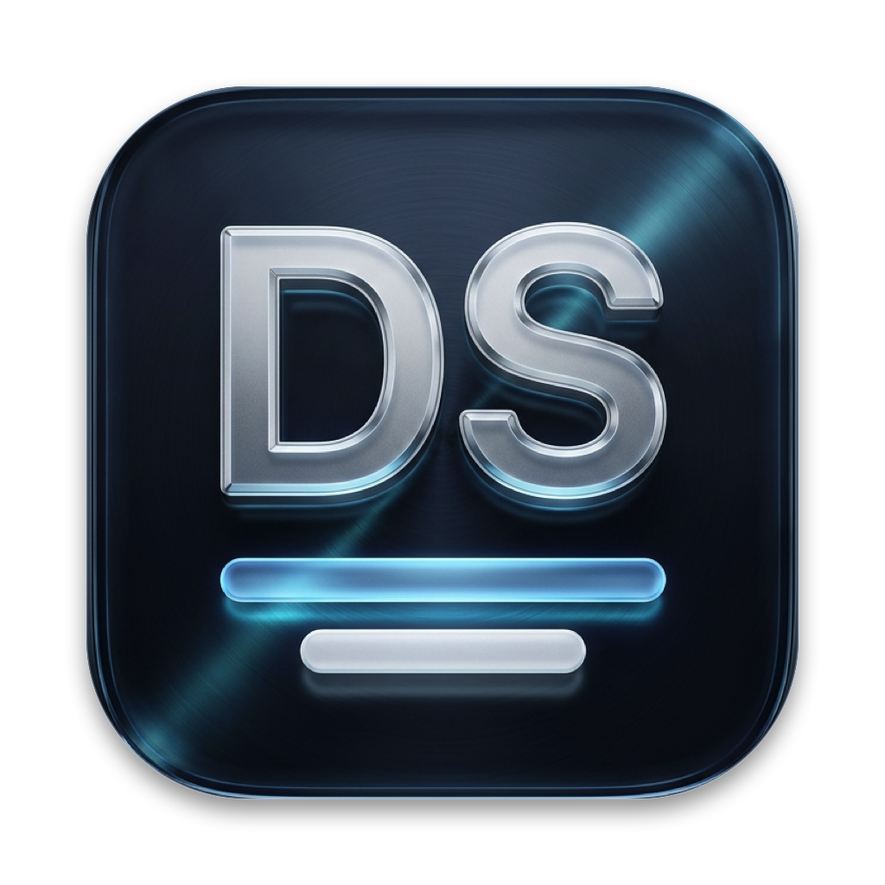

<p align="center">
  
</p>

<h1 align="center">DodoSubs</h1>

<p align="center">
  <strong>PS5 ve LG OLED TV için macOS Liquid Glass canlı Türkçe altyazı &amp; İkiz Türkçe Telefon stüdyosu.</strong><br>
  <em>Real-time Turkish subtitle, Twin Glass Phone mirror, and LG OLED Studio for PS5 &amp; webOS TVs.</em>
</p>

<p align="center">
  <a href="https://github.com/proddogan-cmyk/dodosubs/releases/latest">
    
  </a>
  <a href="LICENSE">
    
  </a>
</p>

---

## İndir / Download

| Platform | Paket | Açıklama |
|---|---|---|
| **macOS (Apple Silicon, macOS 13+)** | **[DodoSubs.dmg](https://github.com/proddogan-cmyk/dodosubs/releases/latest/download/DodoSubs.dmg)** | Sürükle-bırak kurulum paketi (`DodoSubs.app`) |
| **LG webOS TV (`v0.9.66`)** | **[com.couchsubs.tv_0.9.66_all.ipk](https://github.com/proddogan-cmyk/dodosubs/releases/latest/download/com.couchsubs.tv_0.9.66_all.ipk)** | `DodoSubs.app` içine gömülüdür; TV Geliştirici Modu üzerinden kurulur |

> **Not (macOS Gatekeeper):** Uygulama yerel ad-hoc imzalıdır. İlk açılışta macOS uyarı verirse **Sistem Ayarları › Gizlilik ve Güvenlik › Yine de Aç** veya terminalde `xattr -cr /Applications/DodoSubs.app` komutunu kullanabilirsiniz.

---

## DodoSubs'ta Neler Var?

DodoSubs, açık kaynaklı [CouchSubs](https://github.com/yorulmazsinan/couchsubs) ve [chiaki-ng](https://github.com/chiaki-ng/chiaki-ng) altyapısı üzerine inşa edilmiş; özellikle **PS5 + LG OLED webOS 23/24/25** deneyimi için baştan aşağı güçlendirilmiş bir stüdyo sürümüdür:

- **macOS Native Liquid Glass Stüdyo Arayüzü:**
  - Çerçevesiz tam ekran Liquid Glass pencere, sol sabit buzlu cam gezinme rayı (`Stüdyo`, `Canlı Monitör`, `Geçmiş`, `Altyazı & TV`, `Çeviri & Paketler`, `PS5, Ses & OBS`) ve her sekmeden tek tıkla erişilen alt kontrol iskelesi.
  - **Canlı Görsel Sinyal Hattı (`PS5 → Çeviri Motoru → LG OLED TV`)** + canlı oturum kronometresi + **son 24 satırın anlık gecikme bar grafiği**.
  - **Anlık TV Kontrol Rafı:** Oyun sırasında Ayarlar'a girmeden yazı boyutu (`±2 px`), zemin opaklığı, çıktı hedefi (`TV / Mac / İkisi`), oyun paketleri ve yığın animasyonunu canlı değiştirme.
  - **Canlı 16:9 LG OLED TV Simülatörü** + 4 tek-tık sinema ön ayarı (`Sinema OLED`, `Klasik Sarı`, `Tam Örtücü`, `Saf Minimal`).
  - **Tam Ekran Transkript & Arama:** Türkçe/İngilizce anlık arama, kaynak filtreleri (`Tümü / Oyun Paketi / Yapay Zeka`) ve tek tık kopyalama.
- **İkiz Türkçe Telefon (`tv-webos` v0.9.66):**
  - Oyun içi telefonu açtığınızda yanında birebir aynalanan buzlu cam Türkçe akıllı telefon arayüzü: üst saat, kişi/grup başlığı (`3 Members → 3 Üye`), gelen (sol, avatar+gönderici) ve giden (sağ, tema rengi + `✓✓`) mesaj baloncukları, saatler, `"Bugün"/"Dün"` tarih ayırıcıları, 40 mesajlık kaydırma belleği ve sıfır-titreme 60fps FLIP kaydırma takibi.
- **Sinema Gerçekçiliği & 60fps FLIP Altyazı Animasyonu:**
  - Yeni satır geldiğinde eski satırın 3 kademeli derinlikle (`100% → 80% → 74%`) yukarı süzülmesi, 220 ms yumuşak kapanış, italik `[SFX]`/`(ton)`/`♪ müzik ♪` biçimlendirmesi, yumuşak kenarlı örtücü maske ve OLED göz dostu tipografi (`#F5F6F8` / `#FCE26B`).
- **Kalıcı LG OLED Ekran Koruyucu Kalkanı:**
  - Root'suz LG webOS 23/24/25 OLED TV'lerde 3 dakikalık saat ekran koruyucusunu engellemek için Mac'ten her **45 saniyede bir** taze SSAP `getPointerInputSocket` üzerinden görünmez, imleçsiz ve bildirimsiz canlılık sinyali (`YELLOW`) + 5 saniyelik otomatik ekran koruyucu kurtarıcısı.
- **Yüksek Performans:**
  - Sıfır bellek ayırmalı `PanelPresence` NCC şablon takibi (`~0.019 ms/kare`), iç-ekran imza kapısı ve ertelenmiş 2× GPU büyütme ile Mac'te çok düşük CPU tüketimi.

---

## Nasıl Çalışır?

```
PS5 ──HDMI──▶ LG OLED TV (HDMI görüntüsü + DodoSubs Türkçe altyazı & İkiz Telefon katmanı)
 │                                  ▲
 └─ Remote Play ──▶ DodoSubs (Mac) ─┴─ Ev ağı (SSE :8787 + SSAP OLED Kalkanı :3001)
    (ikinci PSN)      OCR → Paket / DeepL / Claude / Gemini → TV
```

Oyunu her zamanki gibi HDMI üzerinden, kendi DualSense kolunuzla ve **sıfır gecikmeyle** oynarsınız. Mac tarafı ikinci bir ücretsiz PSN hesabı ile görüntüyü arka planda okuyup çevirir ve ev ağından TV'nize aktarır.

---

## Kaynaktan Derleme (macOS)

```bash
# 1. Core Swift testleri
swift test --package-path core -c release

# 2. TV webOS JS testleri
node --test scripts/tv-discovery.test.js scripts/tv-screen.test.js scripts/tv-tizen.test.js

# 3. Release DodoSubs.app derlemesi (Apple Silicon)
xcodebuild -project mac/CouchSubs.xcodeproj -scheme CouchSubs -configuration Release \
  -derivedDataPath build/DerivedData ARCHS=arm64 ONLY_ACTIVE_ARCH=YES CODE_SIGN_IDENTITY="-" build
```

---

## Lisans ve Atıf / License & Attribution

Bu proje **GNU Affero General Public License v3.0 (AGPL-3.0)** altında özgür ve açık kaynaklıdır ([LICENSE](LICENSE)).

- Orijinal **[CouchSubs](https://github.com/yorulmazsinan/couchsubs)** projesi (Copyright © 2026 Sinan Yorulmaz, AGPL-3.0) üzerine geliştirilmiş ve genişletilmiştir.
- PS5 Remote Play bağlantısı için **[chiaki-ng](https://github.com/chiaki-ng/chiaki-ng)** (AGPL-3.0) kullanır.
- DodoSubs, Sony Interactive Entertainment veya LG Electronics ile ilişkili değildir. PlayStation ve PS5, Sony Interactive Entertainment Inc.'in ticari markalarıdır.
